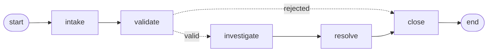

# Lab proof: NormalObjects Strict Complaint Processor (LangGraph)

Everything below comes from saved outputs in [`normalobjects_langgraph.ipynb`](./normalobjects_langgraph.ipynb): the Step 4 test runs and the Step 5 trace cell. Because LLM wording varies between runs, quoted text matches the saved notebook, not necessarily a fresh run.

## 1. Workflow



Five nodes. **`validate` is the only one that branches**: a conditional edge (`route_after_validation`) reads `is_valid` and goes to `investigate`, or straight to `close` for a rejected complaint.

| Node | Job | Uses LLM? |
|---|---|---|
| `intake` | Categorize the complaint (portal, monster, psychic, environmental, other) | Yes |
| `validate` | Check length and category | No |
| `investigate` | Look up evidence in the `LORE` dict by category | No |
| `resolve` | Answer using only the gathered evidence | Yes |
| `close` | Set final status; builds the rejection message if needed | No |

**Design choices**
- `intake` uses the LLM because categorizing free text is a fuzzy task.
- `validate` is plain rules so the gate stays deterministic and auditable.
- `resolve` is prompted to use only the evidence list and to say so if the evidence doesn't cover the complaint.

## 2. State

`ComplaintState` is a `TypedDict` shared by every node:

| Key | Written by | Meaning |
|---|---|---|
| `complaint` | input | raw user text |
| `category` | `intake` | portal / monster / psychic / environmental / other |
| `is_valid`, `validation_reason` | `validate` | gate result and a one-line reason |
| `evidence` | `investigate` | lore facts the answer must rest on |
| `resolution` | `resolve` (or `close` for rejections) | the final answer |
| `status` | every node | where the complaint is in the process |
| `workflow_path` | every node | trace of visited nodes |

`workflow_path` is declared as `Annotated[List[str], operator.add]`. Nodes return **partial updates** (only the keys they changed). A plain key is overwritten by the returned value. With the `operator.add` reducer, each node returns `{"workflow_path": ["intake"]}` and LangGraph appends it to the existing list, so the path accumulates without any node needing to read and copy the old one.

## 3. One query with its trace (accepted)

> The Downside Up portal opens at different times each day. How do I predict when?

Output of `trace_workflow` (what each node wrote to state; `workflow_path` is left out because the numbered steps already show it):

```text
1. [INTAKE]       category: portal
                  status: intake
2. [VALIDATE]     is_valid: True
                  validation_reason: Passed: 80 chars (min 15), category 'portal' is supported
                  status: validated
3. [INVESTIGATE]  evidence: ['Gates to the Upside Down are unstable and open irregularly, not on a fixed schedule.',
                             "Gate activity correlates with Vecna's and the Mind Flayer's activity, not clock time."]
                  status: investigating
4. [RESOLVE]      resolution: The Downside Up portal opens irregularly and is influenced by the unstable nature
                  of the gates, which do not operate on a fixed schedule. Additionally, the timing of the gate
                  activity is linked to the actions of Vecna and the Mind Flayer, rather than specific times of
                  day. Therefore, it is not possible to predict when the portal will open.
                  status: resolved
5. [CLOSE]        resolution: (same text)
                  status: closed
```

**Verification:** every claim in the resolution maps to an evidence line. "Opens irregularly / no fixed schedule" is lore line 1. "Linked to Vecna and the Mind Flayer, not times of day" is lore line 2. Nothing in the answer comes from outside the two lines. The chain is complaint -> `category` -> `evidence` -> `resolution`, all visible in state.

## 4. Rejected path

> This is not a valid complaint about something random

```text
1. [INTAKE]    category: other
               status: intake
2. [VALIDATE]  is_valid: False
               validation_reason: Category 'other' is outside NormalObjects jurisdiction
               status: rejected
3. [CLOSE]     resolution: Rejected: Category 'other' is outside NormalObjects jurisdiction
               status: closed
```

`investigate` and `resolve` never run: the path is `intake -> validate -> close`, and no evidence is gathered or answer generated.

**Overall across 11 complaints** (5 from this lab, 6 from the LangChain lab): 7 took the full path, **4 were rejected**:

- This is not a valid complaint about something random
- My neighbour's dog barks at 3am every single night.
- My friends and I can't agree on a strategy for our bike trip through the woods.
- What is the capital of France?

## 5. Failure case: a plausible answer the evidence doesn't support

> My teenage daughter has psychic powers and keeps breaking the TV with her mind.

Output of `trace_workflow`:

```text
1. [INTAKE]       category: psychic
                  status: intake
2. [VALIDATE]     is_valid: True
                  validation_reason: Passed: 79 chars (min 15), category 'psychic' is supported
                  status: validated
3. [INVESTIGATE]  evidence: ["Eleven's powers are limited by concentration, emotional state, and physical stamina.",
                             'Large or heavy objects cost far more energy, often causing nosebleeds and exhaustion.']
                  status: investigating
4. [RESOLVE]      resolution: The evidence does not specifically address the claim about your daughter's psychic
                  powers breaking the TV. However, it suggests that if her powers are causing physical effects
                  like exhaustion or nosebleeds, it may indicate a limitation in her ability to control them.
                  Therefore, it might be beneficial to help her manage her concentration and emotional state.
                  status: resolved
5. [CLOSE]        resolution: (same text)
                  status: closed
```

**What went wrong:** the category was right and the evidence was found, but the evidence is about Eleven's limits, not about breaking a TV. The resolver admits that, then stretches anyway: it turns "powers are limited by concentration, emotional state and stamina" into "a limitation in her ability to control them" and advice to help her manage her concentration. No evidence line says the daughter has a control problem, or that exhaustion explains a broken TV. The answer sounds grounded because it paraphrases real lore.

**Not stable between runs:** the stretch changed each time I ran this complaint. One run said she "is struggling with concentration or emotional control"; the run above says "a limitation in her ability to control them". Another run (Step 4) said "The evidence does not support the claim ... it is unlikely that she is breaking the TV solely with her mind", which contradicts the user's report using evidence that says nothing about the TV. Same input and same evidence each time, even at `temperature=0`, and a different unsupported conclusion.

**Why the system allows it:** `validate` runs before any evidence exists, and `investigate` fetches by category, not by relevance. Nothing checks that the evidence answers the question before it reaches `resolve`. A fix would be a relevance check after `investigate` with a route to a "can't ground this" outcome. I did not build it.

## 6. Comparison with the LangChain agent

| | LangChain agent | LangGraph workflow |
|---|---|---|
| Who decides the next step | The LLM, per request | The graph; the LLM only fills in values |
| Paths | Open-ended tool order and count | Two: full pipeline, or `intake -> validate -> close` |
| Consistency | Varies between runs (tool choice, random replies) | Same route for the same category; only wording varies |
| Where scope is decided | At runtime, by the agent's tool choice; nothing is rejected | Before any evidence, by a fixed rule (4 categories) |
| Traceability | Reconstruct from message history | `workflow_path` and per-node state are built in |
| Off-pattern input | Handled (bike trip got party wisdom) | Rejected (bike trip, dog) |

- The graph fails by **refusing** (visible in the path). The agent fails by **answering** (harder to spot).
- The **keyword miss** from the LangChain lab (`psychic` vs `psychics`) cannot recur here, because evidence is looked up by category key, not substring. A **different grounding gap** appears instead: the lookup is guaranteed to find evidence, but not evidence that fits the question (section 5).
- The graph's gate is deterministic, but the category itself comes from the intake LLM, so a misclassification still turns into a wrong rejection or wrong evidence.

## 7. Reproduce

- **Model:** `gpt-4o-mini` (`temperature=0`). `gpt-5.5` returned a 403 on my project (noted in the LangChain lab).
- **Python:** 3.12 kernel.
- **Packages:** `%pip install -q langgraph langchain-core langchain-openai python-dotenv` (first code cell; versions not pinned).
- **Key:** copy `.env.example` to `.env` and set `OPENAI_API_KEY=...`. `.env` is listed in `.gitignore` and stays out of git.
- Run the notebook top to bottom. Step 4 needs API access; Step 3's Mermaid text and Step 5's PNG render do not call the LLM (the PNG needs internet for mermaid.ink).
